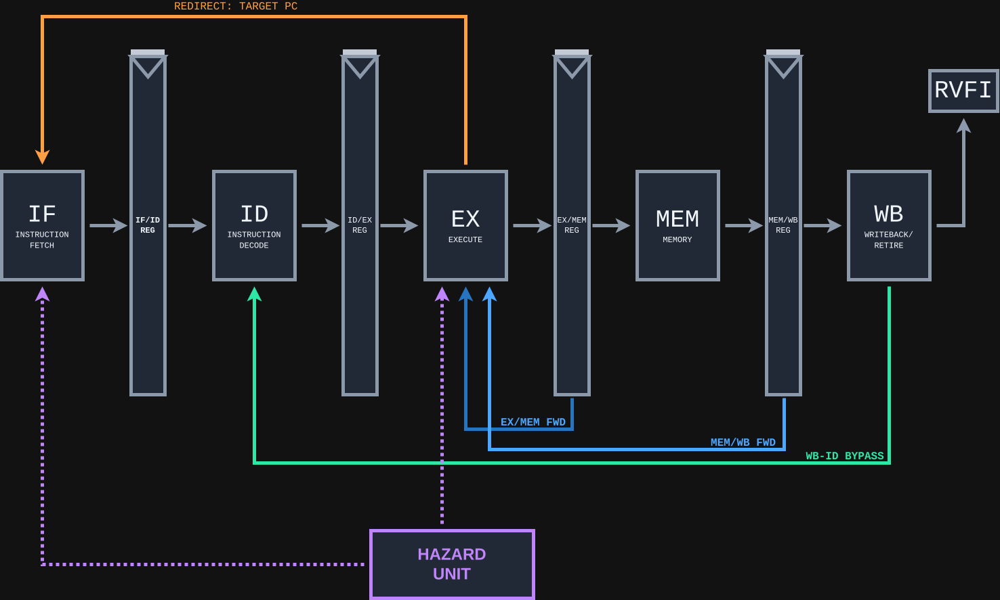

# RISC-V 5-Stage Pipelined Processor

A five-stage, in-order **RV32I processor written in SystemVerilog**, developed from RTL through formal verification, simulation, and deployment on a **Real Digital Urbana (Spartan-7) FPGA**.

The processor implements the RV32I base integer instruction set, resolves pipeline data and control hazards, supports precise exception reporting in a simplified halt model, and connects to FPGA block RAM through request/response memory interfaces.

**Current status — v2.0: FPGA bring-up complete.** The processor has been implemented on the Urbana FPGA, meets **80 MHz** post-route timing, and has successfully executed a BRAM-resident RISC-V smoke-test program on physical hardware. The previous v1.0 milestone established architectural correctness through bounded formal verification and directed simulation.

## Highlights

- **Five-stage pipeline:** Instruction Fetch (IF), Decode (ID), Execute (EX), Memory (MEM), and Writeback (WB).
- **40 RV32I instructions implemented**, including arithmetic, branches, jumps, loads/stores, and system instructions.
- **Hazard handling:** EX/MEM and MEM/WB operand forwarding, load-use stalls, writeback bypass, and wrong-path flushing.
- **Precise exceptions:** Illegal/system instructions and misaligned instruction/data accesses, with faulting side effects suppressed.
- **Bus-connected memory:** Separate instruction and data interfaces, synchronous BRAM, and bus-to-BRAM adapters.
- **Verification:** 37 instruction-model checks, five architectural consistency checks, and one formal cover check passed in the v1 configuration; dedicated Verilator simulations exercise the integrated memory system.
- **Physical FPGA demonstration:** Timing-closed at 80 MHz, with a successful store/load program observed through onboard LEDs.

## FPGA implementation — v2.0

| Property | Result |
| --- | --- |
| Board | Real Digital Urbana |
| FPGA | Xilinx Spartan-7 XC7S50-CSGA324-1 |
| Tool | Vivado 2026.1 |
| External oscillator | 100 MHz |
| CPU clock | **80 MHz** (12.5 ns), generated by Clocking Wizard/MMCM |
| Worst setup slack (WNS) | **+0.181 ns** |
| Worst hold slack (WHS) | **+0.111 ns** |
| Instruction / data memory | Separate inferred FPGA block RAMs |
| Hardware verification | BRAM smoke test passed; expected `0x2B` observed on LEDs |

The FPGA wrapper (`rtl/riscv_fpga_top.sv`) instantiates the clock generator and processor system, synchronizes reset release after MMCM lock, and latches a test result from the architectural retirement interface. The processor system (`rtl/riscv_system.sv`) connects the core to separate instruction- and data-memory BRAM adapters.

### Physical smoke test

The instruction BRAM is initialized with a small RV32I program:

```asm
addi x1, x0, 42      # x1 = 42
addi x2, x1, 1       # x2 = 43; forwarding dependency
sw   x2, 0(x0)       # data memory[0] = 43
lw   x3, 0(x0)       # x3 = 43
jal  x0, 0           # loop
```

When the `lw` instruction at PC `0x0000000C` retires, the FPGA wrapper captures `x3`'s writeback value and drives the onboard LEDs:

| Indicator | Observed result |
| --- | --- |
| LEDs 7–0 | `00101011` (`0x2B`, decimal 43) |
| LED 8 | ON — expected load retired |
| LED 9 | OFF — no fetch fault observed |
| LED 10 | OFF — no data-access fault observed |

This confirms execution of the smoke-test sequence on physical FPGA hardware, including arithmetic, a data dependency, a memory store, a memory load, and architectural retirement. It is **not** an exhaustive on-board test of all RV32I instructions.

## Architecture



| Stage | Responsibilities |
| --- | --- |
| **IF** | Program counter, BRAM-based instruction fetch, response handling, redirects, and discarded wrong-path responses |
| **ID** | Instruction decoding, immediate generation, integer register file, and operand capture |
| **EX** | ALU, forwarding muxes, branch/jump resolution, address generation, and alignment checks |
| **MEM** | BRAM-based byte/halfword/word loads and stores, sign/zero extension, and write masks |
| **WB** | Register writeback and in-order retirement metadata |

**Pipeline control** provides EX/MEM and MEM/WB forwarding, load-use bubbles, memory-stall handling, register-file writeback bypass, and flushing on redirects or accepted exceptions. The ID/EX register also refreshes held operand values from writeback when necessary during memory stalls.

**Memory subsystem:** The core uses a `mem_bus_if` interface request/response channels. `bram_adapter.sv` translates these accesses into synchronous block RAM operations; the instruction-side adapter is read-only, and the data-side adapter supports byte-masked writes. The design currently uses separate local BRAMs rather than caches or external DRAM.

**Exception model:** Exceptions are reported through retirement, with a simplified halt mechanism rather than a privileged-mode trap handler or full operating-system environment.

For more details, see [architecture](docs/architecture.md) and [verification](docs/verification.md).

## Instruction set support

The core implements the **40 RV32I base instructions**:

| Category | Instructions |
| --- | --- |
| Arithmetic / logic | `ADD`, `SUB`, `ADDI`, `SLT`, `SLTU`, `SLTI`, `SLTIU`, `AND`, `ANDI`, `OR`, `ORI`, `XOR`, `XORI` |
| Shifts | `SLL`, `SLLI`, `SRL`, `SRLI`, `SRA`, `SRAI` |
| Upper immediates | `LUI`, `AUIPC` |
| Branches | `BEQ`, `BNE`, `BLT`, `BGE`, `BLTU`, `BGEU` |
| Jumps | `JAL`, `JALR` |
| Loads | `LB`, `LBU`, `LH`, `LHU`, `LW` |
| Stores | `SB`, `SH`, `SW` |
| System / synchronization | `FENCE`, `ECALL`, `EBREAK` |

The 37 standard instruction-model checks exclude `FENCE`, `ECALL`, and `EBREAK`; the latter instructions were tested in dedicated directed system/exception regressions.

## Verification

### v1.0 — Architectural verification

The processor exposes architectural retirement data through a custom `retire_t` interface, mapped to standard RVFI signals by an adapter for [riscv-formal](https://github.com/YosysHQ/riscv-formal).

The v1 configuration passed **43 generated formal checks** under bounded model checking:

- **37 RV32I instruction-model checks** covering arithmetic, shifts, branches, jumps, loads, and stores
- **5 architectural consistency checks:** `reg`, `pc_fwd`, `unique`, `causal`, and `causal_mem`
- **1 cover check:** `cover`

The v1 directed Verilator regressions also passed, covering basic retirement and exceptions, memory accesses, forwarding/load-use hazards, branches/jumps, and system instructions. Formal verification uncovered and helped resolve a WB-to-ID register dependency, misaligned control-flow targets, and misaligned data accesses.

These are **bounded verification results for the configured v1 core**, not a claim that the entire v2 FPGA system has been formally proved.

### v2.0 — Memory integration and hardware validation

The bus and BRAM-based system was exercised with Verilator testbenches, including instruction-memory initialization, instruction retirement, and data-memory store/load behavior. FPGA synthesis confirmed BRAM inference. A routed, timing-closed implementation was programmed onto the Urbana and passed the LED-observed smoke test described above.

See [verification](docs/verification.md) for the verification setup, scope, and limitations.

## Repository layout

```text
riscv-pipelined-cpu/
├── rtl/
│   ├── riscv_pkg.sv
│   ├── riscv_core.sv
│   ├── riscv_system.sv     # Core + instruction & data BRAM
│   ├── hazard_unit.sv
│   ├── if_stage/
│   ├── id_stage/
│   ├── ex_stage/
│   ├── mem_stage/
│   ├── wb_stage/
│   └── pipeline/
├── ip/
│   └── memory/
│       ├── mem_bus_if.sv
│       ├── bram.sv
│       └── bram_adapter.sv
├── fpga/
│   ├── riscv_fpga_top.sv       # Urbana FPGA wrapper
│   ├── riscv_fpga.xdc          # Urbana pins and I/O constraints
│   └── programs/
│       └── bram_smoke.mem      # 1,024-word instruction BRAM image
├── verif/                      # Verilator testbenches and RVFI utilities
├── formal/                     # v1 riscv-formal configuration
├── docs/                       # Architecture, verification, diagrams
└── build/
    └── Makefile
```

## Building and testing

### Requirements

- **Verilator**, `make`, and a C++ toolchain for RTL simulation.
- **Vivado 2026.1** for the Urbana FPGA implementation (or a compatible Vivado installation).
- For the v1 formal checks: **SymbiYosys**, Yosys with Slang support, Boolector, Python 3, and a separate checkout of **riscv-formal**.

### BRAM system simulation

From the repository root:

```bash
make -C build test-bram
```

This exercises the bus-connected processor with initialized instruction BRAM. Other available regression targets are defined in `build/Makefile`.

### FPGA setup

Use `rtl/riscv_fpga_top.sv` as the Vivado top-level module, targeting the **XC7S50-CSGA324 (-1)** device. The design expects:

1. The tracked [`fpga/riscv_fpga.xdc`](fpga/riscv_fpga.xdc), mapping the 100 MHz oscillator, BTN0 reset, and debug LEDs to board pins.
2. A Clocking Wizard instance named `clk_wiz_0`, configured for a **100 MHz input** and **80 MHz output**, with `reset` and `locked` ports enabled. Keep the input constraint at **10 ns**; Vivado derives the **12.5 ns** CPU clock.
3. The [`fpga/programs/bram_smoke.mem`](fpga/programs/bram_smoke.mem) initialization file added to the Vivado project, matching the `"bram_smoke.mem"` value of `IMEM_INIT_FILE` in the FPGA wrapper. Also make the file accessible from the simulation working directory.
4. Full synthesis, implementation, timing analysis, and bitstream generation before programming the FPGA over USB/JTAG.

Press **BTN0** to reset and rerun the smoke test. The expected LEDs are `0x2B` on bits 7–0 and LED 8 illuminated, with LEDs 9 and 10 off.

**Reproducibility note:** The board XDC and program image are tracked under `fpga/`. The Clocking Wizard configuration must also be tracked (for example, its `.xci` or an IP-generation Tcl script); the HDL module alone is not a complete Vivado project.

### Formal verification (v1 configuration)

The v1 configuration is stored in `formal/checks.cfg`. It uses an external sibling checkout of `riscv-formal` rather than vendoring the framework:

```text
pipeline/
├── riscv-pipelined-cpu/
└── riscv-formal/
```

Copy the configuration into the appropriate `riscv-formal/cores/pipelined/` directory, adjust source paths for the checkout, and execute:

```bash
cd ../riscv-formal/cores/pipelined
python3 ../../checks/genchecks.py
make -C checks -j2
```

Refer to `docs/verification.md` for the formal file list, assumptions, and bounded-check depths.

## Roadmap

- [x] **v1.0 — Architecturally verified core:** RV32I implementation, hazard handling, precise exception model, bounded formal verification, and directed regressions
- [x] **v2.0 — FPGA integration:** Bus-based instruction/data BRAM, FPGA clock/reset integration, 80 MHz timing closure, and successful physical smoke test on the Urbana
- [ ] **v3.0 — Performance and system extensions:** Investigate critical-path optimizations, branch handling, additional peripherals, and more substantial FPGA applications

## Related project

[Single-Cycle RISC-V CPU](https://github.com/sen393/riscv-single-cycle-cpu) — the predecessor RV32I implementation, clocked at approximately **67.5 MHz** on the FPGA. The pipelined design's 80 MHz clock is an approximately **18.5% frequency increase**; instruction throughput also depends on CPI and has not been compared with a controlled benchmark.

## Limitations

This is an educational processor and FPGA platform, not a production-ready SoC. The v1 formal results are bounded and configuration-dependent; the v2 hardware demonstration covers a small smoke-test program, not every instruction or corner case. The current system uses local BRAM, a simplified exception/halt model, and no operating system or full privileged-mode implementation. UART, graphics, and other peripherals remain future extensions.
