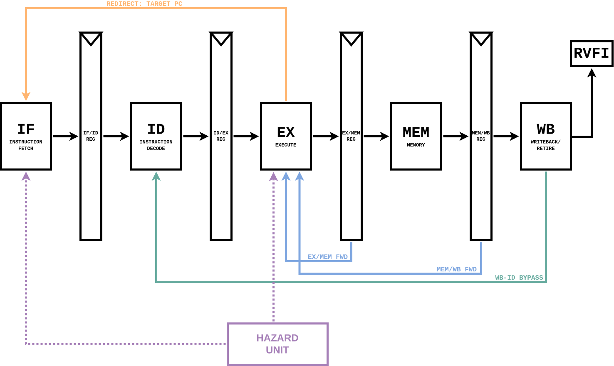

# RISC-V 5-Stage Pipelined Processor

A five-stage, in-order **RV32I processor written in SystemVerilog**, built to explore CPU microarchitecture, pipeline hazards, precise exceptions, and hardware verification.

The project builds on a [single-cycle RV32I processor](https://github.com/sen393/riscv-single-cycle-cpu) and is being developed in three milestones: an architecturally verified core, FPGA integration, and performance-oriented optimizations.

> **Current status:** The core implements the 40 RV32I base instructions. All **37 instruction models available in the configured riscv-formal RV32I suite**, plus **five architectural consistency checks**, have passed bounded formal verification. This is **not** a claim of unbounded proof or complete system-level verification. FPGA implementation is planned, not yet completed.

## Architecture



- **IF — Instruction Fetch:** Program counter, instruction ROM, sequential fetch, and branch/jump redirects.
- **ID — Instruction Decode:** Instruction decoding, immediate generation, and two-read/one-write integer register file.
- **EX — Execute:** ALU operations, forwarded operands, branch decisions, effective-address generation, and address-alignment checks.
- **MEM — Memory:** Byte-, halfword-, and word-sized memory operations with sign/zero extension and write masks.
- **WB — Writeback:** Register writeback and in-order architectural retirement through an RVFI-compatible interface.

### Pipeline control

- EX/MEM and MEM/WB operand forwarding, with load-use stall insertion.
- WB-to-ID register-file bypass for same-cycle read/write dependencies.
- Flushing of younger instructions on taken branches, jumps, and accepted exceptions.
- Instruction- and data-address misalignment detection.
- Exception propagation to retirement with faulting-instruction side effects suppressed.

**Exception model:** The current core uses a simplified exception/halt mechanism for verification; it does not yet implement a complete privileged-mode trap handler or operating-system environment.

## Instruction set support

The core implements the **RV32I unprivileged base instruction set**:

| Category | Instructions |
| --- | --- |
| Integer arithmetic / logic | `ADD`, `SUB`, `ADDI`, `SLT`, `SLTU`, `SLTI`, `SLTIU`, `AND`, `ANDI`, `OR`, `ORI`, `XOR`, `XORI` |
| Shifts | `SLL`, `SLLI`, `SRL`, `SRLI`, `SRA`, `SRAI` |
| Upper immediates | `LUI`, `AUIPC` |
| Branches | `BEQ`, `BNE`, `BLT`, `BGE`, `BLTU`, `BGEU` |
| Jumps | `JAL`, `JALR` |
| Loads | `LB`, `LBU`, `LH`, `LHU`, `LW` |
| Stores | `SB`, `SH`, `SW` |
| Synchronization / system | `FENCE`, `ECALL`, `EBREAK` |

*Implementation support is distinct from formal coverage: `FENCE`, `ECALL`, and `EBREAK` are not part of the 37 standard RV32I instruction-model results summarized below. They require dedicated verification.*

## Verification

The processor exposes retirement information via a custom `retire_t` bundle. An **RVFI adapter** maps that bundle to the standard interface used by [riscv-formal](https://github.com/YosysHQ/riscv-formal). Formal checks run using **SymbiYosys, Yosys/Slang, and Boolector**; simulation and linting use **Verilator**.

### Formal results

| Check | Result | Scope |
| --- | --- | --- |
| RV32I instruction-model checks | **37 / 37 PASS** | Arithmetic, shifts, branches/jumps, loads/stores |
| `reg` | **PASS** | Register consistency |
| `pc_fwd` | **PASS** | PC progression across retirements |
| `unique` | **PASS** | Unique retirement order values |
| `causal` | **PASS** | Register-dependency causality |
| `causal_mem` | **PASS** | Memory-dependency causality |

The reported regression used **bounded model checking**, with instruction checks at depth **15** and architectural consistency checks using the configured reset windows and depths. A deeper `reg` check has also passed at depth **20**. Passing bounded checks does not prove correctness for arbitrary-length executions or guarantee full memory consistency.

### Bugs found through formal verification

1. **WB-to-ID read-after-write hazard:** A consumer in decode could capture an old register value while an older instruction wrote that register back. Fixed by adding register-file write-through bypass.
2. **Misaligned control-flow targets:** Taken branches and jumps could target addresses not aligned to four bytes without raising an exception. Fixed by detecting misalignment in EX and propagating a precise trap.
3. **Misaligned data accesses:** Halfword/word loads and stores could access improperly aligned addresses without reporting a trap. Fixed by checking the effective address in EX and suppressing faulting memory operations.

### Remaining verification work

- Multi-instruction memory consistency (store-to-load behavior and overlapping accesses).
- Directed/random exception and hazard regressions, including side-effect suppression and precise ordering.
- Dedicated checks for `FENCE`, `ECALL`, and `EBREAK`.
- Deeper formal bounds, coverage analysis, and stronger properties where feasible.

## Repository structure

```text
rtl/
  riscv_pkg.sv            # Shared types, controls, pipeline bundles
  riscv_core.sv           # Five-stage integration and pipeline control
  if_stage/               # Fetch and instruction memory
  id_stage/               # Decode, register file, immediate generation
  ex_stage/               # ALU, branches, effective addresses
  mem_stage/              # Load/store datapath and data memory
  wb_stage/               # Register writeback and retirement
  pipeline/               # Pipeline registers and hazard logic
verif/
  rvfi_adapter.sv         # Retirement bundle to RVFI mapping
  rvfi_wrapper.sv         # Formal top-level wrapper
  ...                     # Simulation testbenches
formal/
  checks.cfg              # Saved riscv-formal core configuration
  rtl_files.f             # Formal RTL source list
  formal_instr_rom.v      # Symbolic formal instruction memory
  formal_instr_rom_stub.sv
  riscv-formal-revision.txt  # Tested upstream framework revision
build/
  Makefile                # Simulation/lint commands
```

*Some verification configuration files are stored under `formal/` for reproducibility; the external `riscv-formal` framework itself is not vendored into this repository.*

## Building and testing

### Requirements

- Verilator (SystemVerilog simulation and lint)
- OSS CAD Suite or equivalent installation of Yosys with Slang support, SymbiYosys, and Boolector (formal verification)
- `make` and Python 3
- A separate checkout of `riscv-formal`

### Lint and basic simulation

From the project root:

```bash
make -C build lint
make -C build test-basic
```

### Formal verification

The project currently uses an external, sibling checkout of `riscv-formal`:

```text
pipeline/
  riscv-pipelined-cpu/
  riscv-formal/
```

The repository's `formal/checks.cfg` is the **saved source of truth** for the core-specific checks. Copy it into `riscv-formal/cores/pipelined/checks.cfg` and ensure its source paths match your checkout. The configuration must reference the project's RTL file list, RVFI wrapper, formal ROM stub, and formal ROM implementation.

With the toolchain available on `PATH`, generate and execute the checks from the framework directory:

```bash
cd ../riscv-formal/cores/pipelined
python3 ../../checks/genchecks.py
make -C checks -j2
```

Individual checks can be run with `sby -f checks/insn_addi_ch0.sby` (or the corresponding generated job name). Generated logs, waveforms, and solver outputs should remain untracked.

**Reproducibility note:** Absolute paths in a copied `checks.cfg` may need adjustment for a new machine. Pin the upstream framework revision recorded in `formal/riscv-formal-revision.txt` to reproduce the same setup.

## Roadmap

- **v1 — Architecturally verified RV32I core (in progress):** Complete formal and custom multi-instruction verification, document assumptions, and establish a repeatable regression.
- **v2 — FPGA system:** Integrate the core with memory and peripherals, bring it up on an FPGA, and explore video output and interactive programs.
- **v3 — Microarchitectural optimization:** Improve performance and implementation characteristics through measured pipeline and datapath changes.

## Related project

- [Single-Cycle RISC-V CPU](https://github.com/sen393/riscv-single-cycle-cpu) — the predecessor project implementing RV32I in a single-cycle architecture.

## Project status and limitations

This is an educational hardware-design and verification project, **not** a production-ready CPU or a complete SoC. Current formal results are bounded and rely on the configured symbolic instruction-memory model and RVFI assumptions. FPGA validation and system-level software execution are future milestones.
